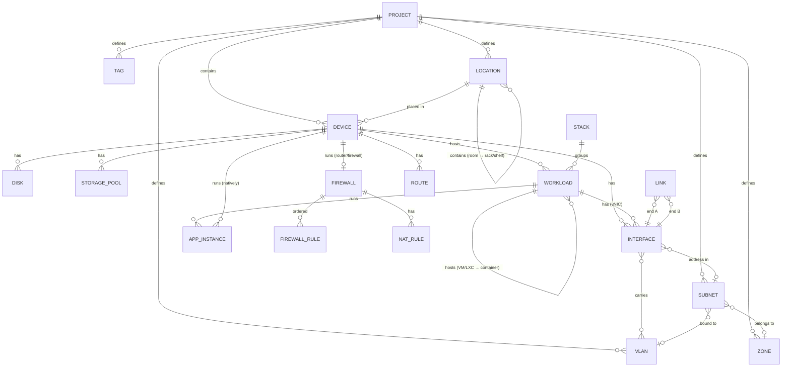

# Server Planner — model danych (v0.3)

> Status: **zaakceptowany, v0.4** (v0.3: lokalizacje i forma urządzeń, § 4.3; v0.4: zmiany z implementacji etapu 1, § 13 M5) · Data: 2026-11-11
> Podstawa: `01-funkcjonalnosci.md` v0.4 (decyzje D1–D9)
> Notacja: typy w składni TypeScript — to opis struktury, nie decyzja o implementacji (ta zapadnie w `03-architektura.md`).

---

## 1. Zasady ogólne

| #   | Zasada                                                                                                                                                                                  | Uzasadnienie                                                                                               |
| --- | --------------------------------------------------------------------------------------------------------------------------------------------------------------------------------------- | ---------------------------------------------------------------------------------------------------------- |
| Z1  | **Model znormalizowany**: każda encja w mapie `Record<Id, Entity>`, relacje przez ID, nie przez zagnieżdżanie.                                                                          | Łatwe undo/redo, diff snapshotów, referencje z wielu miejsc (reguły firewalla, asercje, przepływy).        |
| Z2  | **ID z prefiksem typu** + losowy sufiks: `dev_7f3k2q`, `if_…`, `lnk_…`.                                                                                                                 | Czytelność w JSON i w debugowaniu; z ID wiadomo, czego dotyczy referencja.                                 |
| Z3  | **Domena oddzielona od układu**: położenie na canvasie trzymane w osobnej sekcji `layout`.                                                                                              | Ten sam model w wielu widokach (Topology, Inventory, Rack); zmiana pozycji nie „brudzi” danych domenowych. |
| Z4  | **Przechowujemy tylko dane wejściowe**. Wszystko, co da się wyliczyć (wykorzystanie zasobów, problemy, dostępność, wynegocjowana prędkość łącza), liczą silniki na bieżąco.             | Brak niespójności; silniki są czystymi funkcjami `(Project, Catalog) → Wynik`.                             |
| Z5  | **Jednostki bazowe**: pamięć i dyski w **bajtach**, przepustowość w **Mb/s**, moc w **W**, CPU w **rdzeniach** (liczba zmiennoprzecinkowa: `0.5` = pół rdzenia), czas w ISO 8601 (UTC). | Brak pomyłek GB/GiB; formatowanie wyłącznie w UI (`Intl`).                                                 |
| Z6  | **Pozycje z katalogu są kopiowane** do projektu; zostaje tylko referencja informacyjna `catalogRef { id, version }`.                                                                    | Aktualizacja katalogu nigdy nie zmienia istniejącego projektu (LIB‑03).                                    |
| Z7  | **Teksty generowane przez silniki** to zawsze `{ code, params }`, nigdy gotowe zdania.                                                                                                  | i18n (01, rozdz. 7).                                                                                       |
| Z8  | Plik projektu ma **`schemaVersion`**; import przechodzi przez łańcuch migracji `v1 → v2 → …`.                                                                                           | Stare eksporty zawsze da się otworzyć.                                                                     |

### Typy pomocnicze

```ts
type Id = string; // np. "dev_7f3k2q9x"
type IsoDate = string; // "2026-11-11T10:00:00Z"
type Bytes = number;
type Mbps = number;
type Watts = number;
type Cores = number;
type Cidr = string; // "192.168.10.0/24"
type IpAddress = string; // "192.168.10.5"
type HexColor = string; // "#3b82f6"
type PaletteKey = 'violet' | 'sky' | 'teal' | 'pink' | 'indigo' | 'sand' | 'lime' | 'cyan'; // 04 § 2.4
type ColorRef = PaletteKey | HexColor; // klucz palety (zmienia się z motywem) lub własny hex
type LocalizedText = { en: string; [locale: string]: string }; // treści katalogu

type Protocol = 'tcp' | 'udp' | 'icmp' | 'any';
type PortRange = { from: number; to: number }; // pojedynczy port: from === to

type CatalogRef = { id: string; version: string }; // skąd skopiowano dane
type Confidence = 'curated' | 'imported' | 'estimated';
```

### Prefiksy ID

| Prefiks | Encja                      | Prefiks | Encja        |
| ------- | -------------------------- | ------- | ------------ |
| `prj_`  | Project                    | `vln_`  | Vlan         |
| `dev_`  | Device                     | `sub_`  | Subnet       |
| `if_`   | Interface                  | `zon_`  | Zone         |
| `lnk_`  | Link                       | `fwr_`  | FirewallRule |
| `pool_` | StoragePool                | `nat_`  | NatRule      |
| `dsk_`  | Disk                       | `rte_`  | Route        |
| `wl_`   | Workload (VM/LXC/kontener) | `tag_`  | Tag          |
| `dnet_` | DockerNetwork              |         |              |
| `stk_`  | Stack                      | `note_` | Note         |
| `loc_`  | Location                   |         |              |
| `app_`  | AppInstance                | `asr_`  | Assertion    |
| `snap_` | Snapshot                   |         |              |

---

## 2. Mapa encji



---

## 3. Plik projektu (eksport JSON)

```ts
interface ProjectFile {
  format: 'server-planner/project';
  schemaVersion: 1;
  appVersion: string; // wersja aplikacji, która zapisała plik
  exportedAt: IsoDate;
  project: Project;
  snapshots?: Snapshot[]; // opcjonalnie — użytkownik wybiera przy eksporcie
}

interface Project {
  id: Id;
  name: string;
  description?: string;
  createdAt: IsoDate;
  updatedAt: IsoDate;
  catalogVersion: string; // wersja katalogu, z którą projekt był ostatnio otwierany
  settings: ProjectSettings;

  // --- domena (Z1) ---
  devices: Record<Id, Device>;
  interfaces: Record<Id, Interface>;
  links: Record<Id, Link>;
  workloads: Record<Id, Workload>;
  stacks: Record<Id, Stack>;
  dockerNetworks: Record<Id, DockerNetwork>;
  apps: Record<Id, AppInstance>;
  vlans: Record<Id, Vlan>;
  subnets: Record<Id, Subnet>;
  zones: Record<Id, Zone>;
  routes: Record<Id, Route>;
  tags: Record<Id, Tag>;
  assertions: Record<Id, Assertion>;
  locations: Record<Id, Location>; // rozdz. 4.3

  // --- układ (Z3) ---
  layout: Layout;
}

interface ProjectSettings {
  capacityThresholds: { warning: number; critical: number }; // 0.7, 0.9
  defaultOvercommit: { cpu: number; memory: number }; // 4, 1
  storageFreeReserve: number; // 0.1 = 10% puli zostaje wolne
  energyPrice?: { perKwh: number; currency: string };
  currency: string; // "PLN"
}
```

---

## 4. Urządzenia i sprzęt

```ts
type DeviceKind =
  | 'internet'
  | 'modem'
  | 'router'
  | 'firewall'
  | 'switch'
  | 'access-point'
  | 'server'
  | 'mini-pc'
  | 'sbc'
  | 'nas'
  | 'ups'
  | 'patch-panel'
  | 'client'; // laptop, PC, telefon, TV, IoT — podtyp w `clientType`

interface Device {
  id: Id;
  kind: DeviceKind;
  clientType?:
    | 'pc'
    | 'laptop'
    | 'phone'
    | 'tv'
    | 'console'
    | 'iot'
    | 'camera'
    | 'printer'
    | 'other';
  name: string; // nazwa wyświetlana
  hostname?: string;
  description?: string;
  tagIds: Id[];
  physicalLabel?: string; // LBL — tekst etykiety do druku
  catalogRef?: CatalogRef;

  formFactor?: FormFactor; // rozdz. 4.3 — domyślnie z katalogu / z `kind`; brak dla 'internet'
  placement?: Placement; // brak = urządzenie poza lokalizacjami

  hardware: Hardware; // dla 'internet' / 'patch-panel' — pusty
  os?: OsInstall; // tylko urządzenia obliczeniowe (server, mini-pc, sbc, nas)
  docker?: DockerRuntime; // Docker bezpośrednio na hoście (Debian/Ubuntu)
  switching?: SwitchCapabilities; // switch / router / AP
  firewall?: Firewall; // router / firewall
  wifi?: WifiConfig; // access-point / router z Wi-Fi
  ups?: UpsSpec;
  purchase?: Purchase;
}
```

> **Co ma własne ID, a co nie:**
> - **Interfejsy** leżą w mapie projektu (`interfaces`) i wskazują właściciela (`owner`) — odwołują się do nich łącza, reguły i adresacja.
> - **Dyski i pule** są zagnieżdżone w `hardware`, ale mają ID unikalne w całym projekcie, bo odwołują się do nich workloady (`poolId`).
> - **CPU, RAM, GPU** są zagnieżdżone bez ID — nic się do nich nie odwołuje. RAM jest listą modułów, żeby dało się planować rozbudowę („2× 8 GB → 2× 32 GB”) i sprawdzać sloty. Jeśli kiedyś będą potrzebne odwołania (np. GPU passthrough do konkretnej VM), dodamy ID migracją schematu.

### 4.1 Sprzęt

```ts
interface Hardware {
  cpus: CpuSpec[]; // >1 = wiele gniazd
  memory?: MemorySpec;
  disks: Disk[];
  pools: StoragePool[];
  gpus: GpuSpec[];
  power?: { idleW: Watts; loadW: Watts };
}

interface CpuSpec {
  model: string; // "Intel Core i5-8500T"
  cores: number;
  threads: number;
  baseGhz?: number;
  boostGhz?: number;
  tdpW?: Watts;
  arch: 'amd64' | 'arm64';
  perf?: {
    score: number; // względna wydajność wielordzeniowa; i5-8500T = 100 (06 § 3.1)
    source: 'blender-opendata' | 'estimated' | 'user';
    samples?: number;
  };
  igpu?: GpuSpec;
  catalogRef?: CatalogRef;
}

interface MemorySpec {
  modules: MemoryModule[]; // źródło prawdy; suma RAM i zajęte sloty są wyliczane
  type?: 'DDR3' | 'DDR4' | 'DDR5' | 'LPDDR4' | 'LPDDR5';
  slotsTotal?: number; // brak = pamięć wlutowana / nieznane
  maxBytes?: Bytes; // max obsługiwany przez płytę (LIB-05)
  ecc?: boolean;
}

interface MemoryModule {
  sizeBytes: Bytes; // 17179869184 = 16 GiB
  count: number; // 2 = dwie identyczne kości
  speedMts?: number; // 3200
  soldered?: boolean; // wlutowana (np. część mini PC / SBC) — nie zajmuje slotu
}

interface Disk {
  id: Id;
  name: string; // "nvme0", "Bay 1"
  type: 'hdd' | 'ssd-sata' | 'ssd-nvme' | 'emmc' | 'sd';
  sizeBytes: Bytes;
  model?: string;
}

interface StoragePool {
  id: Id;
  name: string; // "local-lvm", "tank"
  layout:
    | 'single'
    | 'mirror'
    | 'raid0'
    | 'raid5'
    | 'raid6'
    | 'raid10'
    | 'raidz1'
    | 'raidz2'
    | 'raidz3';
  diskIds: Id[];
  filesystem?: 'zfs' | 'lvm-thin' | 'ext4' | 'xfs' | 'btrfs' | 'ntfs' | 'refs';
  purpose?: ('os' | 'vm-disks' | 'containers' | 'data' | 'backup')[];
  arcBytes?: Bytes; // rezerwa RAM dla ZFS ARC (wlicza się w capacity RAM)
}

interface GpuSpec {
  model: string;
  vramBytes?: Bytes;
  features: GpuFeature[];
}
type GpuFeature = 'quicksync' | 'nvenc' | 'vcn' | 'cuda' | 'rocm' | 'tpu' | 'npu';

interface UpsSpec {
  capacityVa: number;
  capacityW: Watts;
  batteryWh?: number;
}

interface Purchase {
  status: 'owned' | 'to-buy' | 'optional';
  price?: number;
  currency?: string;
  url?: string;
}
```

### 4.2 System operacyjny

```ts
type OsId = 'proxmox-ve' | 'debian' | 'ubuntu-server' | 'windows-server';

interface OsInstall {
  osId: OsId;
  version: string; // "8.3", "12", "24.04", "2025"
  overrideOverhead?: Resources; // nadpisanie domyślnego narzutu z katalogu
  bootPoolId?: Id;
}
```

Zgodność (co wolno uruchomić pod danym OS) **nie jest zapisywana w projekcie** — pochodzi z katalogu (`CatalogOs.capabilities`, rozdz. 9.3), a naruszenia raportuje walidacja (VAL‑11).

---

### 4.3 Forma urządzenia i lokalizacje (D9)

```ts
type FormFactor =
  | { mount: 'rack'; units: number; width: '10in' | '19in' } // units: 1, 2, 4…
  | {
      mount: 'standalone';
      shape: 'tower' | 'mini-pc' | 'desktop' | 'nas' | 'wall' | 'ceiling' | 'sbc' | 'other';
    };

interface Placement {
  locationId: Id;
  u?: number; // tylko w racku: najniższy zajmowany U (1 = dół szafy)
  onShelf?: boolean; // standalone w racku, na półce zajmującej `shelfUnits` lokalizacji
}

type Location = Room | Shelf | Rack;

interface LocationBase {
  id: Id;
  name: string; // "Living room", "Office shelf", "Closet rack"
  parentId?: Id; // LOC-07: rack/półka w pomieszczeniu; max głębokość 2
  description?: string;
}
interface Room extends LocationBase {
  kind: 'room';
}
interface Shelf extends LocationBase {
  kind: 'shelf';
}
interface Rack extends LocationBase {
  kind: 'rack';
  units: number; // 6–42
  width: '10in' | '19in';
  depthMm?: number;
  shelves?: { u: number; units: number }[]; // LOC-05: półki montowane w racku
  powerBudgetW?: Watts; // LOC-06: np. z PDU/UPS
}
```

Zasady:

- **Lokalizacja to dane domenowe** (walidacja U, zasilanie, eksport), a jej prostokąt na canvasie — dane układu (`layout.locations`, rozdz. 7). Prostokąt lokalizacji zagnieżdżonej (`parentId`) jest **względny wobec rodzica**, tak jak pozycje urządzeń w lokalizacji.
- **Przynależność wynika z `placement`, nie z geometrii.** Przeciągnięcie urządzenia do pojemnika to komenda `device.place`, która ustawia `placement`; samo położenie piksela niczego nie zmienia.
- **W racku pozycja urządzenia jest wyliczana** z `u` i `formFactor.units` — nie trzymamy `x/y` w `layout.nodes`. W pomieszczeniu i na półce `x/y` jest względne wobec pojemnika.
- Urządzenie rack‑mount może stać w pomieszczeniu lub na półce (dozwolone). Urządzenie standalone w racku wymaga `onShelf` i półki pod danym `u`.
- Reguły walidacji: `VAL_RACK_OVERLAP`, `VAL_RACK_OUT_OF_RANGE`, `VAL_RACK_WIDTH` (19″ w 10″), `VAL_RACK_NO_SHELF`, `VAL_RACK_POWER` (warning).
- Migracja istniejących projektów: `formFactor` z `kind` (router/switch → rack 1U 19″, nas → standalone/nas, mini-pc → standalone/mini-pc, access-point → standalone/ceiling, client → standalone/other), `placement` puste.

---

## 5. Workloady, Docker, aplikacje

### 5.1 Host workloadu

Wszystko, co może „gościć” workload lub aplikację, wskazujemy jednym typem:

```ts
type HostRef =
  | { type: 'device'; id: Id } // urządzenie z OS
  | { type: 'workload'; id: Id }; // VM / LXC / kontener
```

### 5.2 Workload

```ts
type Workload = VmWorkload | LxcWorkload | ContainerWorkload;

interface WorkloadBase {
  id: Id;
  name: string;
  host: HostRef;
  tagIds: Id[];
  description?: string;
  autostart?: boolean;
}

interface VmWorkload extends WorkloadBase {
  kind: 'vm';
  vmid?: number; // Proxmox VMID
  resources: AllocatedResources;
  guestOs: OsInstall; // Debian / Ubuntu / Windows Server
  docker?: DockerRuntime;
  passthrough?: { gpu?: boolean; pciDevices?: string[] };
}

interface LxcWorkload extends WorkloadBase {
  kind: 'lxc';
  vmid?: number;
  resources: AllocatedResources;
  template: string; // "debian-12", "ubuntu-24.04"
  unprivileged: boolean;
  docker?: DockerRuntime; // Docker w LXC (nesting)
}

interface ContainerWorkload extends WorkloadBase {
  kind: 'container';
  stackId?: Id;
  image: string; // "lscr.io/linuxserver/jellyfin"
  tag: string; // "latest", "10.10.3"
  network:
    | { mode: 'host' }
    | { mode: 'none' }
    | { mode: 'docker-network'; dockerNetworkId: Id; ip?: IpAddress };
  portMappings: PortMapping[]; // tylko dla trybu bridge
  volumes: Volume[];
  limits?: { cpu?: Cores; memoryBytes?: Bytes }; // brak = "unbounded" (CAP)
  gpu?: boolean;
  catalogRef?: CatalogRef; // komponent aplikacji z katalogu
}

interface AllocatedResources {
  cpu: Cores; // vCPU / limit rdzeni
  memoryBytes: Bytes;
  disks: { poolId: Id; sizeBytes: Bytes; name?: string }[];
}

interface PortMapping {
  hostPort: number;
  containerPort: number;
  protocol: 'tcp' | 'udp';
  hostIp?: IpAddress; // brak = 0.0.0.0 (wszystkie interfejsy)
}

interface Volume {
  name: string;
  containerPath: string;
  type: 'named' | 'bind' | 'nfs' | 'smb';
  poolId?: Id; // lokalna pula, z której zużywa miejsce
  remote?: { appId?: Id; deviceId?: Id; path?: string }; // nfs/smb: skąd (np. NAS) — ważne dla przepływów
  sizeBytes?: Bytes;
  growthBytesPerMonth?: Bytes;
}
```

### 5.3 Docker

```ts
interface DockerRuntime {
  enabled: true;
  networkIds: Id[]; // DockerNetwork; domyślny "bridge" tworzony automatycznie
}

interface DockerNetwork {
  id: Id;
  host: HostRef; // na którym runtime istnieje
  name: string; // "bridge", "proxy", "iot_macvlan"
  driver: 'bridge' | 'macvlan' | 'ipvlan';
  subnet?: Cidr; // wewnętrzna podsieć Dockera (bridge) lub fragment podsieci LAN (macvlan)
  parentInterfaceId?: Id; // macvlan/ipvlan: interfejs hosta (z VLANem)
  internal?: boolean; // brak wyjścia na zewnątrz
}

interface Stack {
  id: Id;
  name: string; // "immich"
  host: HostRef;
  catalogRef?: CatalogRef; // aplikacja katalogowa, z której powstał stos
}
```

### 5.4 Instancja aplikacji

Aplikacja to **usługa** — coś, co nasłuchuje na portach, ma wymagania i wzorce ruchu. Działa w kontenerze, LXC, VM lub natywnie na urządzeniu.

```ts
interface AppInstance {
  id: Id;
  name: string; // "Jellyfin"
  runsOn: HostRef; // zwykle kontener; może być LXC/VM/urządzenie (natywnie)
  catalogRef?: CatalogRef;
  role?: 'app' | 'database' | 'cache' | 'worker' | 'proxy' | 'dns' | 'other';
  tagIds: Id[];

  listeners: Listener[]; // porty, na których usługa nasłuchuje (wewnątrz runtime)
  requirements: AppRequirements; // skopiowane z katalogu lub ręczne (SW-07)
  loadProfile?: { profileId: string; params?: Record<string, number> }; // SW-08
  dependencies: AppDependency[]; // SW-10
  trafficPatterns: TrafficPattern[]; // skopiowane z katalogu (rozdz. 9.2), edytowalne
  confidence: Confidence;
}

interface Listener {
  port: number;
  protocol: 'tcp' | 'udp';
  purpose?: string; // "web-ui", "api", "dns", "nfs"
}

interface AppRequirements {
  min: Resources;
  recommended: Resources;
}

interface Resources {
  cpu: Cores;
  memoryBytes: Bytes;
  diskBytes: Bytes;
  gpu?: { required: boolean; features: GpuFeature[] };
}

interface AppDependency {
  capability: string; // "postgresql", "redis", "smtp", "media-storage"
  satisfiedBy?: Id; // AppInstance, która spełnia zależność
  optional: boolean;
}
```

**Jak to się składa — przykład Immich na Proxmoxie:**

```
Device "pve1" (os: proxmox-ve)
└── Workload vm "docker-vm" (guestOs: debian, docker.enabled)
    ├── Stack "immich"
    │   ├── Workload container "immich-server"   ── AppInstance "Immich"         (listeners 2283/tcp)
    │   ├── Workload container "immich-ml"       ── AppInstance "Immich ML"      (worker)
    │   ├── Workload container "immich-postgres" ── AppInstance "PostgreSQL"     (database)
    │   └── Workload container "immich-redis"    ── AppInstance "Redis"          (cache)
    └── DockerNetwork "immich_default" (bridge)
```

---

## 6. Sieć

### 6.1 Interfejsy i łącza

```ts
type InterfaceKind =
  | 'rj45'
  | 'sfp'
  | 'sfp+'
  | 'sfp28'
  | 'qsfp+' // fizyczne
  | 'wifi-radio' // radio AP / klienta Wi-Fi
  | 'wan' // port WAN routera (fizyczny, specjalna rola)
  | 'bridge' // vmbr0, br0, przełącznik w hypervisorze
  | 'vlan' // sub-interfejs: eth0.30, vmbr0.30, SVI
  | 'vnic' // karta wirtualna VM/LXC
  | 'bond'; // P2: LACP

interface Interface {
  id: Id;
  owner: { type: 'device' | 'workload'; id: Id };
  name: string; // "eth0", "Port 5", "vmbr0", "net0"
  kind: InterfaceKind;
  index?: number; // kolejność na liście portów urządzenia
  speedMbps?: Mbps; // fizyczne: maksymalna prędkość portu
  poe?: { role: 'pd' | 'pse'; standard?: 'af' | 'at' | 'bt'; drawW?: Watts };
  mac?: string;

  parentId?: Id; // vlan → interfejs nadrzędny; port fizyczny → bridge (członkostwo)
  vlanTag?: number; // kind 'vlan' lub vnic z tagiem (Proxmox "tag=30")

  switchport?: Switchport; // L2 — porty switcha/AP/bridge’a VLAN-aware
  addresses: IpAssignment[]; // L3; UI w MVP obsługuje jeden adres (model gotowy na więcej)
  zoneId?: Id; // nadpisanie strefy (domyślnie wynika z podsieci)
  enabled: boolean;
}

interface Switchport {
  mode: 'access' | 'trunk';
  accessVlanId?: Id; // mode access
  nativeVlanId?: Id; // mode trunk: VLAN nietagowany
  allowedVlanIds?: Id[] | 'all'; // mode trunk
}

interface IpAssignment {
  mode: 'static' | 'dhcp' | 'dhcp-reservation';
  address?: IpAddress; // static / reservation; dla 'dhcp' — puste (adres dynamiczny)
  subnetId?: Id; // wyliczalne z adresu, zapisywane dla 'dhcp'
}

interface Link {
  id: Id;
  a: Id; // Interface
  b: Id; // Interface
  medium: 'copper' | 'fiber' | 'dac' | 'wifi' | 'virtual'; // 'virtual' = vNIC ↔ bridge (niepokazywane na canvasie)
  cable?: {
    label?: string;
    color?: HexColor;
    lengthM?: number;
    category?: 'cat5e' | 'cat6' | 'cat6a' | 'om3' | 'os2';
  };
  ssidId?: string; // tylko medium 'wifi': SSID, przez który klient jest połączony
  tagIds: Id[];
}

interface SwitchCapabilities {
  layer: 2 | 3;
  managed: boolean; // niezarządzalny → wszystkie porty access VLAN 1 (nietagowane), walidacja ostrzega przy próbie trunku
  poeBudgetW?: Watts;
}

interface WifiConfig {
  ssids: {
    id: string;
    name: string;
    vlanId?: Id;
    bands: ('2.4' | '5' | '6')[];
    clientIsolation: boolean;
    security: 'open' | 'wpa2' | 'wpa3';
  }[];
}
```

**Ważne decyzje modelowania:**

- **Łącza fizyczne i wirtualne** to ta sama encja `Link`; rodzaj wynika z typów interfejsów (`vnic`/`bridge` = wirtualne). Łącza wirtualne **nie są rysowane** na canvasie. Użytkownik edytuje je jak w Proxmoxie — w inspectorze VM/LXC na liście **„Network devices”** (`net0: bridge vmbr0, tag 30, firewall`). Dodanie pozycji tworzy `Interface(kind: 'vnic')` + `Link` do wybranego bridge'a; usunięcie usuwa oba. `Link` wirtualny nie może istnieć bez vNIC.
- **Wi‑Fi**: klient bezprzewodowy łączy się linkiem `medium: 'wifi'` z radiem AP; VLAN wynika z wybranego SSID (`Link.ssidId`).
- **Wirtualizacja**: VM/LXC ma interfejs `vnic` połączony **linkiem** z `bridge` hosta. Dzięki temu silnik symulacji przechodzi po jednym grafie: kontener → sieć Dockera → vNIC → bridge → port fizyczny → switch.
- **Kontener w trybie bridge** nie ma własnego `Interface` — jego ruch wychodzi przez interfejs gospodarza z NAT Dockera (silnik modeluje to na podstawie `DockerNetwork` + `PortMapping`). Kontener **macvlan** dostaje własny adres w podsieci LAN (pole `network.ip`).

### 6.2 VLANy, podsieci, strefy

```ts
interface Vlan {
  id: Id;
  vid: number; // 1–4094
  name: string; // "IoT"
  color: ColorRef;
  description?: string;
}

interface Subnet {
  id: Id;
  cidr: Cidr;
  vlanId?: Id;
  zoneId?: Id;
  gateway?: IpAddress;
  dhcp?: {
    enabled: boolean;
    rangeStart: IpAddress;
    rangeEnd: IpAddress;
    serverRef?: { type: 'device' | 'app'; id: Id }; // router lub np. Pi-hole jako DHCP
  };
  dns?: {
    servers: ({ type: 'ip'; value: IpAddress } | { type: 'app'; id: Id })[];
    domain?: string;
  };
  name?: string;
}

interface Zone {
  id: Id;
  name: string; // "WAN", "LAN", "IoT", "Guest", "Mgmt"
  kind: 'wan' | 'internal'; // WAN — strefa internetu
  color: ColorRef;
  intraZone: 'allow' | 'deny'; // ruch wewnątrz tej samej strefy (przez router)
}
```

### 6.3 Firewall, NAT, routing

Firewall jest **właściwością urządzenia** (router/firewall), bo reguły ewaluuje konkretne urządzenie, przez które przechodzi ruch między podsieciami.

```ts
interface Firewall {
  defaultAction: 'allow' | 'deny'; // dla ruchu międzystrefowego bez dopasowanej reguły
  rules: FirewallRule[]; // kolejność = priorytet (first match)
  nat: NatRule[];
  stateful: true; // ruch powrotny dozwolony (01, 8d pkt 6)
}

interface FirewallRule {
  id: Id;
  enabled: boolean;
  action: 'allow' | 'deny';
  protocol: Protocol;
  source: Endpoint;
  destination: Endpoint;
  ports?: PortRange[]; // port docelowy; brak = wszystkie
  description?: string;
  log?: boolean;
}

type Endpoint =
  | { type: 'any' }
  | { type: 'internet' }
  | { type: 'zone'; id: Id }
  | { type: 'subnet'; id: Id }
  | { type: 'device'; id: Id }
  | { type: 'workload'; id: Id }
  | { type: 'app'; id: Id } // rozwijane do IP hosta + portów listenerów
  | { type: 'cidr'; value: Cidr };

type NatRule =
  | { id: Id; kind: 'masquerade'; outInterfaceId: Id; sourceZoneIds?: Id[] }
  | {
      id: Id;
      kind: 'port-forward';
      inInterfaceId: Id;
      protocol: 'tcp' | 'udp';
      externalPort: number;
      target: { appId: Id; port: number } | { ip: IpAddress; port: number };
    };

interface Route {
  id: Id;
  deviceId: Id;
  destination: Cidr; // "0.0.0.0/0" = domyślna
  via?: IpAddress;
  interfaceId?: Id;
}
```

> Trasy do podsieci bezpośrednio podłączonych **nie są zapisywane** — silnik wylicza je z interfejsów L3 (Z4).

### 6.4 Węzeł „Internet”

Urządzenie `kind: 'internet'` z jednym interfejsem `wan` i strefą typu `wan`. Symbolizuje cały internet: jest celem testu „ma internet?” i źródłem dla „ekspozycji z internetu”. W projekcie może być najwyżej jedno (walidacja).

---

## 7. Oznaczenia, układ, asercje, snapshoty

```ts
interface Tag {
  id: Id;
  name: string;
  color: ColorRef;
}

interface Assertion {
  // SIM-06
  id: Id;
  name?: string;
  source: Endpoint;
  destination: Endpoint;
  protocol: Protocol;
  port?: number;
  expect: 'reachable' | 'blocked';
  enabled: boolean;
}

interface Layout {
  viewport?: { x: number; y: number; zoom: number };
  nodes: Record<Id, NodeLayout>; // klucz: Device / Note (urządzenia w racku — bez wpisu, pozycja z U)
  links: Record<Id, { routing: 'straight' | 'orthogonal'; waypoints?: { x: number; y: number }[] }>;
  locations: Record<
    Id,
    { rect: { x: number; y: number; w: number; h: number }; collapsed?: boolean }
  >;
  groupByLocation: boolean; // LOC-08 — false = ramki ukryte
  notes: Record<Id, Note>;
}

interface NodeLayout {
  x: number; // jednostki siatki; względne wobec lokalizacji, jeśli urządzenie ma `placement`
  y: number;
  collapsed?: boolean; // zwinięta/rozwinięta lista workloadów na karcie urządzenia
}

interface Note {
  id: Id;
  text: string;
  rect: { x: number; y: number; w: number; h: number };
}

interface Snapshot {
  // PRJ-07
  id: Id;
  name: string; // "current", "after upgrade"
  createdAt: IsoDate;
  project: Omit<Project, 'id'>; // pełna kopia stanu
}
```

**Co jest na canvasie:** lokalizacje (pomieszczenia, półki, racki) jako pojemniki, urządzenia, notatki i łącza fizyczne. Workloady i aplikacje wyświetlane są **wewnątrz karty urządzenia** (rozwijana lista) i w inspectorze — nie są osobnymi węzłami. Łącza wirtualne (vNIC ↔ bridge) nie są rysowane — edytowane w inspectorze (rozdz. 6.1).

---

## 8. Wyniki silników (nie zapisywane)

Silniki są czystymi funkcjami. Ich wyniki trafiają do UI i cache'u w pamięci; nigdy do pliku projektu (Z4).

```ts
type EntityRef = {
  type:
    | 'device'
    | 'interface'
    | 'link'
    | 'workload'
    | 'app'
    | 'vlan'
    | 'subnet'
    | 'zone'
    | 'rule'
    | 'pool';
  id: Id;
};

// --- walidacja (M8a) ---
interface Issue {
  code: string; // "VAL_01"
  severity: 'error' | 'warning' | 'info';
  params: Record<string, string | number>;
  targets: EntityRef[];
  fix?: { code: string; params: Record<string, unknown> }; // akcja "Fix"
}

// --- capacity (M9) ---
interface CapacityReport {
  host: EntityRef;
  mode: 'allocated' | 'expected';
  cpu: ResourceUsage;
  memory: ResourceUsage;
  storage: (ResourceUsage & { poolId: Id })[];
  gpu?: { required: GpuFeature[]; available: GpuFeature[]; ok: boolean };
  children: CapacityReport[]; // rekurencja: VM/LXC
}
interface ResourceUsage {
  capacity: number; // po narzucie i overcommicie
  used: number;
  ratio: number; // used / capacity
  status: 'ok' | 'warning' | 'critical' | 'over';
  breakdown: { ref: EntityRef; amount: number }[];
}

// --- symulacja (M8b/c) ---
interface ReachabilityResult {
  verdict: 'reachable' | 'blocked' | 'unknown';
  steps: SimStep[];
  blockedAt?: number; // indeks kroku z porażką
  path: { devices: Id[]; links: Id[] }; // do podświetlenia na canvasie (O-08)
  fix?: { command: string; payload: unknown }; // „Suggest fix” — np. firewall.addRule nad regułą blokującą
}
interface SimStep {
  ref: EntityRef;
  layer: 'dns' | 'l2' | 'l3' | 'firewall' | 'nat' | 'docker' | 'app';
  decision: 'pass' | 'fail';
  code: string; // "SIM_L2_VLAN_NOT_ALLOWED", "SIM_FW_RULE_DENY" — pełna lista: SIM_CODES w packages/engine
  params: Record<string, string | number>;
  ruleRef?: EntityRef;
}
// --- dostęp (SIM-02/03) ---
// AnalysisResult.internet: Record<Id, 'full' | 'partial' | 'none'> — urządzenia i VM/LXC z adresem;
// sondy tcp/443, tcp/80, udp/53, icmp do Internetu: wszystkie = full, część = partial, żadna = none.
interface ServiceVisibility {
  appId: Id;
  port: number; // port widziany w sieci (opublikowany port hosta dla kontenera w sieci bridge)
  protocol: Transport;
  purpose?: string;
  result: ReachabilityResult;
}
interface FlowRunResult {
  flowId: string;
  bindings: Record<string, EntityRef>; // rola → konkretna encja
  hops: {
    from: EntityRef;
    to: EntityRef;
    protocol: Protocol;
    port?: number;
    result: ReachabilityResult;
    bandwidthMbps?: Mbps;
  }[];
}
```

---

## 9. Katalog

### 9.1 Pliki publikowane przez workflow

```
catalog/dist/
├── manifest.json        # wersja, lista plików z sumami SHA-256, statusy źródeł
├── apps.json
├── devices.json
├── cpus.json
├── os.json
└── CHANGELOG.json       # zmiany względem poprzedniej wersji
```

```ts
interface CatalogManifest {
  format: 'server-planner/catalog';
  schemaVersion: 1;
  catalogVersion: string; // "2026.46" = rok.tydzień ISO
  generatedAt: IsoDate;
  minAppVersion: string; // starsza aplikacja nie pobiera tej wersji
  files: { name: string; sha256: string; bytes: number; records: number }[];
  sources: {
    id: string;
    name: string;
    url: string;
    license: string;
    status: 'ok' | 'failed' | 'stale';
    fetchedAt?: IsoDate;
    records: number;
    error?: string;
  }[];
}
```

### 9.1a Katalog efektywny w aplikacji

Schematy Zod wszystkich typów katalogu: `packages/model/src/schema/catalog.ts`. Aplikacja pracuje na `Catalog { format: 'server-planner/catalog'; catalogVersion; generatedAt; apps; devices; cpus; os }` — w MVP to warstwa kurowana (YAML) zbudowana w czasie builda; w 1.0 scalana z pobranym `catalog/dist`. Komponenty `role` jak `AppInstance['role']` (`app | database | cache | worker | proxy | dns | other`); `trafficPatterns[].id` i `flows[].id` unikalne w aplikacji.

Wstawianie do projektu (kopia z `catalogRef`): `device.applyModel` (D‑05) i `app.addFromCatalog` (D‑06/D‑07) w `packages/model/src/commands/catalog.ts`. Aplikacja ze stosu = kontener na komponent + `AppInstance` na komponent; główna instancja niesie wymagania całej aplikacji, wzorce ruchu i zależności (`satisfiedBy` → instancja komponentu z `providedByComponent`).

### 9.2 Aplikacja katalogowa

```ts
interface CatalogApp {
  id: string; // slug: "jellyfin"
  name: string;
  description: LocalizedText;
  categories: string[]; // "media", "home-automation", "dns", …
  website?: string;
  repository?: string;
  license?: string;
  logo?: string; // URL lub ID ikony
  popularity?: number;
  source: string[]; // ID źródeł, z których powstał rekord
  confidence: Confidence;

  deployment: {
    kind: 'single' | 'stack';
    components: CatalogAppComponent[]; // single = 1 komponent
    native?: { os: OsId[]; notes?: LocalizedText }; // instalacja bez Dockera (np. LXC, Windows)
  };
  requirements: { min: Resources; recommended: Resources };
  loadProfiles?: CatalogLoadProfile[];
  dependencies: { capability: string; optional: boolean; providedByComponent?: string }[];
  provides?: string[]; // capability, które aplikacja spełnia: "dns", "reverse-proxy", "postgresql"
  trafficPatterns: TrafficPattern[];
  flows: CatalogFlow[];
}

interface CatalogAppComponent {
  key: string; // "server", "ml", "db"
  name: string;
  role: AppInstance['role'];
  image: string;
  defaultTag: string;
  arch: ('amd64' | 'arm64')[];
  platform: 'linux' | 'windows';
  listeners: Listener[];
  defaultPortMappings?: PortMapping[];
  volumes: {
    name: string;
    containerPath: string;
    purpose: 'config' | 'data' | 'media' | 'cache';
    defaultSizeBytes?: Bytes;
  }[];
  requirements?: { min: Resources; recommended: Resources }; // gdy znane per komponent
}

interface CatalogLoadProfile {
  id: string; // "idle", "typical", "peak"
  name: LocalizedText;
  params?: { key: string; name: LocalizedText; default: number; min: number; max: number }[]; // "transcodes"
  resources: Resources; // przy parametrze domyślnym
  perParam?: Record<string, Partial<Resources>>; // przyrost na jednostkę parametru
}
```

### 9.3 Wzorce ruchu i przepływy

To nasza kurowana warstwa (01, rozdz. 5.2) — podstawa symulacji D4.

```ts
type PeerSelector =
  | { kind: 'lan-clients' } // klienci w strefach wewnętrznych
  | { kind: 'internet' }
  | { kind: 'dns' } // serwer DNS podsieci (z Subnet.dns)
  | { kind: 'dependency'; capability: string } // np. "postgresql"
  | { kind: 'device-kind'; deviceKind: DeviceKind; clientType?: Device['clientType'] } // np. IoT
  | { kind: 'self-component'; key: string }; // inny komponent tego samego stosu

interface TrafficPattern {
  id: string;
  direction: 'inbound' | 'outbound';
  peer: PeerSelector;
  protocol: 'tcp' | 'udp';
  port?: number; // inbound: port własnego listenera; outbound: port celu
  purpose: string; // "web-ui", "metadata-fetch", "device-polling"
  required: boolean; // false = funkcja opcjonalna (np. zdalny dostęp)
  bandwidth?: { typicalMbps: Mbps; peakMbps: Mbps };
}

interface CatalogFlow {
  // "proces" uruchamiany przez użytkownika (FLW-01)
  id: string; // "jellyfin.play-movie"
  name: LocalizedText; // "Client plays a movie"
  description?: LocalizedText;
  roles: {
    key: string;
    name: LocalizedText;
    selector: PeerSelector | { kind: 'self' };
    userPicks: boolean;
  }[];
  steps: {
    from: string; // klucz roli
    to: string;
    protocol: 'tcp' | 'udp';
    port?: number; // brak = port listenera roli docelowej o danym purpose
    purpose?: string;
    resolveDns?: boolean; // przed krokiem — zapytanie DNS (osobny hop)
    bandwidthMbps?: Mbps;
    optional?: boolean; // np. "media na NAS" — tylko gdy rola jest powiązana
  }[];
}
```

**Przykład — Jellyfin:**

```json
{
  "id": "jellyfin.play-movie",
  "name": { "en": "Client plays a movie" },
  "roles": [
    {
      "key": "client",
      "name": { "en": "Client" },
      "selector": { "kind": "lan-clients" },
      "userPicks": true
    },
    {
      "key": "server",
      "name": { "en": "Jellyfin" },
      "selector": { "kind": "self" },
      "userPicks": false
    },
    {
      "key": "storage",
      "name": { "en": "Media storage" },
      "selector": { "kind": "dependency", "capability": "media-storage" },
      "userPicks": true
    }
  ],
  "steps": [
    {
      "from": "client",
      "to": "server",
      "protocol": "tcp",
      "purpose": "web-ui",
      "resolveDns": true,
      "bandwidthMbps": 40
    },
    {
      "from": "server",
      "to": "storage",
      "protocol": "tcp",
      "port": 2049,
      "optional": true,
      "bandwidthMbps": 40
    }
  ]
}
```

### 9.4 Sprzęt i systemy

```ts
interface CatalogDevice {
  id: string; // "lenovo-m720q"
  kind: DeviceKind;
  vendor: string;
  model: string;
  hardware: Omit<Hardware, 'disks' | 'pools'> & { defaultDisks?: Omit<Disk, 'id'>[] };
  formFactor: FormFactor; // D9 — kopiowane do Device.formFactor przy wstawieniu
  ports: { name: string; kind: InterfaceKind; speedMbps?: Mbps; poe?: Interface['poe'] }[];
  switching?: SwitchCapabilities;
  expansion?: { pcieSlots?: number; m2Slots?: number; sataBays?: number };
  priceHint?: { amount: number; currency: string; asOf: IsoDate };
  source: string[];
  confidence: Confidence;
}

interface CatalogCpu extends CpuSpec {
  id: string;
  vendor: 'intel' | 'amd' | 'arm' | 'other';
  source: string[];
  confidence: Confidence;
}

interface CatalogOs {
  id: OsId;
  name: string;
  versions: { version: string; releasedAt?: IsoDate; eol?: IsoDate }[];
  role: 'hypervisor' | 'server';
  overhead: Resources; // domyślny narzut hosta
  arch: ('amd64' | 'arm64')[];
  capabilities: {
    vm: boolean;
    lxc: boolean;
    docker: 'native' | 'discouraged' | 'windows-containers-only' | 'unsupported';
  };
  defaultInterfaces?: { name: string; kind: InterfaceKind }[]; // np. Proxmox: vmbr0
}
```

---

## 10. Przechowywanie w przeglądarce (IndexedDB)

| Store         | Klucz                     | Zawartość                                                                    |
| ------------- | ------------------------- | ---------------------------------------------------------------------------- |
| `projects`    | `id`                      | metadane: nazwa, daty, miniatura, rozmiar (szybka lista PRJ‑02)              |
| `projectData` | `id`                      | pełny `Project`                                                              |
| `snapshots`   | `id` (indeks `projectId`) | `Snapshot`                                                                   |
| `history`     | `projectId`               | stos undo/redo (opcjonalnie — przetrwanie odświeżenia strony)                |
| `catalog`     | `catalogVersion`          | pliki katalogu; trzymane 2 ostatnie wersje (cofnięcie)                       |
| `settings`    | klucz                     | ustawienia aplikacji (motyw, język, data ostatniego sprawdzenia katalogu, …) |
| `locks`       | `projectId`               | znacznik otwartej karty (PRJ‑06)                                             |

---

## 11. Wersjonowanie i migracje

- `schemaVersion` projektu i katalogu są **niezależne**.
- Każda zmiana niekompatybilna = nowa wersja + funkcja migracji `migrate_vN_to_vN+1(data)`; import uruchamia łańcuch migracji.
- Plik z **nowszą** wersją niż obsługiwana → czytelny błąd „Update the app to open this file”.
- Migracje pokryte testami na zapisanych przykładowych plikach (`fixtures/schema/v1/*.json`, generowane przez `pnpm --filter @server-planner/model fixtures:write`).
- Projekty w IndexedDB migrowane przy otwarciu (z kopią zapasową wersji sprzed migracji).

---

## 12. Przykład minimalnego projektu

Router z dwiema podsieciami (LAN, IoT), switch, Proxmox z jedną VM i kontenerem Pi‑hole.

```json
{
  "format": "server-planner/project",
  "schemaVersion": 1,
  "appVersion": "0.1.0",
  "exportedAt": "2026-11-11T12:00:00Z",
  "project": {
    "id": "prj_a1b2c3",
    "name": "Home lab",
    "createdAt": "2026-11-11T10:00:00Z",
    "updatedAt": "2026-11-11T12:00:00Z",
    "catalogVersion": "2026.46",
    "settings": {
      "capacityThresholds": { "warning": 0.7, "critical": 0.9 },
      "defaultOvercommit": { "cpu": 4, "memory": 1 },
      "storageFreeReserve": 0.1,
      "currency": "PLN"
    },
    "vlans": {
      "vln_lan": { "id": "vln_lan", "vid": 20, "name": "LAN", "color": "sky" },
      "vln_iot": { "id": "vln_iot", "vid": 30, "name": "IoT", "color": "pink" }
    },
    "zones": {
      "zon_wan": {
        "id": "zon_wan",
        "name": "WAN",
        "kind": "wan",
        "color": "sand",
        "intraZone": "deny"
      },
      "zon_lan": {
        "id": "zon_lan",
        "name": "LAN",
        "kind": "internal",
        "color": "sky",
        "intraZone": "allow"
      },
      "zon_iot": {
        "id": "zon_iot",
        "name": "IoT",
        "kind": "internal",
        "color": "pink",
        "intraZone": "allow"
      }
    },
    "subnets": {
      "sub_lan": {
        "id": "sub_lan",
        "cidr": "192.168.20.0/24",
        "vlanId": "vln_lan",
        "zoneId": "zon_lan",
        "gateway": "192.168.20.1",
        "dhcp": { "enabled": true, "rangeStart": "192.168.20.100", "rangeEnd": "192.168.20.199" },
        "dns": { "servers": [{ "type": "app", "id": "app_pihole" }] }
      },
      "sub_iot": {
        "id": "sub_iot",
        "cidr": "192.168.30.0/24",
        "vlanId": "vln_iot",
        "zoneId": "zon_iot",
        "gateway": "192.168.30.1"
      }
    },
    "devices": {
      "dev_inet": {
        "id": "dev_inet",
        "kind": "internet",
        "name": "Internet",
        "tagIds": [],
        "hardware": { "cpus": [], "disks": [], "pools": [], "gpus": [] }
      },
      "dev_rtr": {
        "id": "dev_rtr",
        "kind": "router",
        "name": "Router",
        "tagIds": [],
        "formFactor": { "mount": "rack", "units": 1, "width": "10in" },
        "placement": { "locationId": "loc_rack", "u": 12 },
        "hardware": { "cpus": [], "disks": [], "pools": [], "gpus": [] },
        "firewall": {
          "defaultAction": "deny",
          "stateful": true,
          "rules": [
            {
              "id": "fwr_1",
              "enabled": true,
              "action": "allow",
              "protocol": "any",
              "source": { "type": "zone", "id": "zon_lan" },
              "destination": { "type": "any" }
            },
            {
              "id": "fwr_2",
              "enabled": true,
              "action": "allow",
              "protocol": "udp",
              "ports": [{ "from": 53, "to": 53 }],
              "source": { "type": "zone", "id": "zon_iot" },
              "destination": { "type": "app", "id": "app_pihole" }
            }
          ],
          "nat": [{ "id": "nat_1", "kind": "masquerade", "outInterfaceId": "if_rtr_wan" }]
        }
      },
      "dev_pve": {
        "id": "dev_pve",
        "kind": "mini-pc",
        "name": "pve1",
        "hostname": "pve1",
        "tagIds": [],
        "catalogRef": { "id": "lenovo-m720q", "version": "2026.46" },
        "formFactor": { "mount": "standalone", "shape": "mini-pc" },
        "placement": { "locationId": "loc_shelf" },
        "os": { "osId": "proxmox-ve", "version": "8.3" },
        "hardware": {
          "cpus": [{ "model": "Intel Core i5-8500T", "cores": 6, "threads": 6, "arch": "amd64" }],
          "memory": {
            "type": "DDR4",
            "slotsTotal": 2,
            "modules": [{ "sizeBytes": 17179869184, "count": 2 }]
          },
          "disks": [
            { "id": "dsk_1", "name": "nvme0", "type": "ssd-nvme", "sizeBytes": 1000204886016 }
          ],
          "pools": [
            {
              "id": "pool_local",
              "name": "local-lvm",
              "layout": "single",
              "diskIds": ["dsk_1"],
              "filesystem": "lvm-thin"
            }
          ],
          "gpus": []
        }
      }
    },
    "workloads": {
      "wl_vm1": {
        "id": "wl_vm1",
        "kind": "vm",
        "name": "docker-vm",
        "host": { "type": "device", "id": "dev_pve" },
        "tagIds": [],
        "resources": {
          "cpu": 2,
          "memoryBytes": 4294967296,
          "disks": [{ "poolId": "pool_local", "sizeBytes": 34359738368 }]
        },
        "guestOs": { "osId": "debian", "version": "12" },
        "docker": { "enabled": true, "networkIds": ["dnet_bridge"] }
      },
      "wl_pihole": {
        "id": "wl_pihole",
        "kind": "container",
        "name": "pihole",
        "host": { "type": "workload", "id": "wl_vm1" },
        "tagIds": [],
        "image": "pihole/pihole",
        "tag": "latest",
        "network": { "mode": "docker-network", "dockerNetworkId": "dnet_bridge" },
        "portMappings": [
          { "hostPort": 53, "containerPort": 53, "protocol": "udp" },
          { "hostPort": 8080, "containerPort": 80, "protocol": "tcp" }
        ],
        "volumes": [
          {
            "name": "pihole-config",
            "containerPath": "/etc/pihole",
            "type": "named",
            "poolId": "pool_local",
            "sizeBytes": 536870912
          }
        ]
      }
    },
    "apps": {
      "app_pihole": {
        "id": "app_pihole",
        "name": "Pi-hole",
        "runsOn": { "type": "workload", "id": "wl_pihole" },
        "role": "dns",
        "tagIds": [],
        "catalogRef": { "id": "pihole", "version": "2026.46" },
        "listeners": [
          { "port": 53, "protocol": "udp", "purpose": "dns" },
          { "port": 80, "protocol": "tcp", "purpose": "web-ui" }
        ],
        "requirements": {
          "min": { "cpu": 0.5, "memoryBytes": 268435456, "diskBytes": 536870912 },
          "recommended": { "cpu": 1, "memoryBytes": 536870912, "diskBytes": 2147483648 }
        },
        "dependencies": [],
        "trafficPatterns": [],
        "confidence": "curated"
      }
    },
    "interfaces": { "…": "porty routera, switcha, vmbr0, vNIC VM — pominięte dla zwięzłości" },
    "links": {},
    "stacks": {},
    "dockerNetworks": {},
    "routes": {},
    "tags": {},
    "assertions": {},
    "locations": {
      "loc_rack": {
        "id": "loc_rack",
        "kind": "rack",
        "name": "Closet rack",
        "units": 12,
        "width": "10in"
      },
      "loc_shelf": { "id": "loc_shelf", "kind": "shelf", "name": "Office shelf" }
    },
    "layout": {
      "nodes": { "dev_inet": { "x": 0, "y": 0 }, "dev_pve": { "x": 1, "y": 2 } },
      "links": {},
      "locations": {
        "loc_rack": { "rect": { "x": -2, "y": 3, "w": 10, "h": 12 } },
        "loc_shelf": { "rect": { "x": 12, "y": 3, "w": 10, "h": 8 } }
      },
      "groupByLocation": true,
      "notes": {}
    }
  }
}
```

Pełny, poprawny przykład (z interfejsami i łączami) powstanie jako fixture testowy przy implementacji.

---

## 13. Rozstrzygnięte kwestie modelu

| #   | Kwestia                                      | Decyzja                                                                                                                                  |
| --- | -------------------------------------------- | ---------------------------------------------------------------------------------------------------------------------------------------- |
| M1  | CPU/RAM/GPU — osobne encje czy zagnieżdżone? | **Zagnieżdżone bez ID; RAM jako lista modułów** (rozdz. 4.1). Osobne ID dopiero, gdy pojawi się realna potrzeba odwołań.                 |
| M2  | Edycja łączy vNIC ↔ bridge                   | **Lista „Network devices” w inspectorze VM/LXC**, jak w Proxmoxie; łącza wirtualne nierysowane na canvasie (rozdz. 6.1).                 |
| M3  | Wiele adresów IP na interfejsie              | **Model: tablica; UI w MVP: jeden adres.** VLANy na routerze obsługiwane przez sub‑interfejsy, każdy z własnym IP.                       |
| M4  | Rack vs urządzenia wolnostojące (D9)         | **`Device.formFactor` + encja `Location` (room/shelf/rack) + `Device.placement`** (rozdz. 4.3). Zastępuje `Group` i `hardware.physical`. |
| M5  | Rodzaj łącza vNIC ↔ bridge                   | **`Link.medium: 'virtual'`** — jawna wartość zamiast wnioskowania z typów interfejsów; ułatwia filtrowanie łączy na canvasie (etap 1, 2026-11-11). |
