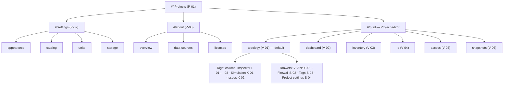

# Server Planner — mapa widoków i sitemapa (v0.1)

> Status: **zaakceptowany, v0.1** · Data: 2026-11-11
> Podstawa: `01-funkcjonalnosci.md` v0.4 (ID funkcji), `05-projekt-ui.md` v0.2 (zachowania), `04-design-system.md` (komponenty)
> Cel: kompletny spis **każdego osobnego widoku**, który trzeba zaprojektować i zbudować — podstawa sitemapy, routingu, makiet i planu prac.

---

## 0. Typy widoków i konwencje

| Typ                | Prefiks ID | Definicja                                                                    | Adresowalny URL‑em?            |
| ------------------ | ---------- | ---------------------------------------------------------------------------- | ------------------------------ |
| **Strona**         | `P`        | Pełny ekran poza projektem                                                   | tak — trasa                    |
| **Widok projektu** | `V`        | Główna zawartość edytora projektu (wspólny top bar)                          | tak — trasa                    |
| **Panel**          | `I` / `X`  | Prawa kolumna edytora: inspector (`I`) lub panel zastępujący inspector (`X`) | tak — parametr `panel` / `sel` |
| **Szuflada**       | `S`        | Panel 720 px wysuwany z prawej nad canvasem (edytory globalne)               | tak — parametr `panel`         |
| **Dialog**         | `D`        | Okno modalne                                                                 | nie                            |
| **Nakładka**       | `O`        | Popover, menu, karta lub warstwa na canvasie                                 | nie                            |
| **Stan**           | `T`        | Wariant widoku: pusty, błąd, ładowanie, tylko odczyt                         | —                              |

**Schemat adresów:**

- Trasy: `#/`, `#/settings/:section`, `#/about/:section`, `#/p/:projectId/:view`.
- Parametry widoku projektu: `?sel=<id>[,<id>]` — zaznaczenie; `?panel=issues|sim|vlans|firewall:<deviceId>|tags|settings` — otwarty panel lub szuflada; `?tab=capacity|hardware|software|network` — zakładka inspectora; `?sim=reach&from=<id>&to=<id>&port=8096` — parametry testu (link do wyniku symulacji).
- Dialogi i nakładki nie mają adresu (`Esc` je zamyka, przycisk Wstecz przeglądarki również).

**Priorytety** jak w `01` (P0 = MVP). **Makieta**: ✅ jest na canvasie · ◐ częściowo · — brak.

---

## 1. Sitemapa



Drzewo tekstowe (dla README / dokumentacji):

```
#/                              Projects
├── #/settings/appearance       Settings › Appearance
├── #/settings/catalog          Settings › Catalog
├── #/settings/units            Settings › Units & costs
├── #/settings/storage          Settings › Storage
├── #/about/overview            About
├── #/about/data-sources        About › Data sources
├── #/about/licenses            About › Open-source licenses
└── #/p/:id                     Project (→ /topology)
    ├── /topology               Topology (canvas)            P0
    ├── /dashboard              Dashboard                    P1
    ├── /inventory              Inventory                    P1
    ├── /ip                     IP Plan                      P1
    ├── /access                 Access                       P1
    └── /snapshots              Snapshots & diff             P1
#/dev/design                    Component gallery (dev build only)
```

---

## 2. Strony globalne (`P`)

| ID    | Nazwa                  | Trasa                                        | Zawartość                                                                                     | Funkcje                | Prio     | Makieta |
| ----- | ---------------------- | -------------------------------------------- | --------------------------------------------------------------------------------------------- | ---------------------- | -------- | ------- |
| P-01  | **Projects**           | `#/`                                         | Lista kart projektów, New / Import / From template, baner ochrony danych, stopka z katalogiem | PRJ‑01, 02, 04, 05, 08 | P0       | ✅      |
| P-02  | **Settings**           | `#/settings/:section`                        | Nawigacja sekcji po lewej (240 px) + treść                                                    | SET‑01…04              | P0 / P1  | ✅      |
| P-02a | › Appearance           | `#/settings/appearance`                      | Motyw: System / Dark / Light; (P1) gęstość canvasu — DS2                                      | SET‑01                 | P0       | —       |
| P-02b | › Catalog              | `#/settings/catalog`                         | Wersja i data, auto‑sprawdzanie, Check now, status źródeł, changelog, Roll back               | SET‑03, CAT‑04         | P1       | —       |
| P-02c | › Units & costs        | `#/settings/units`                           | Waluta, cena kWh, domyślne progi capacity i overcommit dla nowych projektów                   | SET‑02                 | P1       | —       |
| P-02d | › Storage              | `#/settings/storage`                         | Zużycie IndexedDB, Persist data, Export all, Delete all data                                  | PRJ‑05                 | P0       | ✅      |
| P-03  | **About**              | `#/about/:section`                           | Nawigacja sekcji + treść                                                                      | D6                     | P0       | ✅      |
| P-03a | › Overview             | `#/about/overview`                           | Wersja, licencja MIT, repo, zgłaszanie błędów, Recommended (selfh.st)                         |                        | P0       | —       |
| P-03b | › Data sources         | `#/about/data-sources`                       | Tabela źródeł katalogu z licencjami i datami (`06` § 5)                                       | D6, CAT                | P0       | ✅      |
| P-03c | › Open-source licenses | `#/about/licenses`                           | Lista zależności i ich licencji (generowana przy buildzie)                                    |                        | P0       | —       |
| P-04  | **Not found**          | każda nieznana trasa / `#/p/<nieistniejący>` | „Project not found” / „Page not found” + Back to projects                                     |                        | P0       | —       |
| P-05  | Component gallery      | `#/dev/design`                               | Wszystkie komponenty i stany, oba motywy (tylko build deweloperski)                           | `04` § 9               | P0 (dev) | —       |

---

## 3. Widoki projektu (`V`)

Wspólna powłoka: top bar (logo, nazwa projektu ▾, zakładki widoków, liczniki problemów, Export, Simulate). Zakładki w top barze: **Topology · Dashboard · Inventory · IP Plan · Access**; Snapshots — z menu projektu.

| ID   | Nazwa         | Trasa        | Zawartość                                                                                                             | Funkcje                 | Prio | Makieta          |
| ---- | ------------- | ------------ | --------------------------------------------------------------------------------------------------------------------- | ----------------------- | ---- | ---------------- |
| V-01 | **Topology**  | `/topology`  | Biblioteka + canvas + prawa kolumna (I / X)                                                                           | CAN, LOC, NET, SIM      | P0   | ✅ (dark, light) |
| V-02 | **Dashboard** | `/dashboard` | Kafle: zasoby łącznie, wykorzystanie per host, problemy, wynik asercji, BOM (koszt), energia, PoE/UPS (✅ kod, etap 14) | CAP‑09, CAP‑07          | P1   | —                |
| V-03 | **Inventory** | `/inventory` | Tabela urządzeń / workloadów / aplikacji (przełącznik), grupowanie po lokalizacji, edycja inline, inspector po prawej | VIEW‑02, EXP‑03         | P1   | —                |
| V-04 | **IP Plan**   | `/ip`        | Karty podsieci z pulą DHCP + tabela adresów, konflikty, wolne zakresy                                                 | VIEW‑03, NET‑04, EXP‑04 | P1   | —                |
| V-05 | **Access**    | `/access`    | Macierz strefa × strefa / urządzenie × urządzenie + ekspozycja z internetu + lista asercji (✅ kod, etap 13)          | VIEW‑04, SIM‑04…06      | P1   | —                |
| V-06 | **Snapshots** | `/snapshots` | Lista snapshotów (lewa kolumna) + diff dwóch wersji (dodane / usunięte / zmienione elementy), Restore (✅ kod, etap 16b; podgląd diffu na canvasie — później) | PRJ‑07                  | P1   | —                |
| V-07 | Services map  | `/services`  | Mapa aplikacji i zależności                                                                                           | VIEW‑07                 | P2   | —                |
| V-08 | Logical L3    | `/logical`   | Automatyczny diagram stref i podsieci                                                                                 | VIEW‑06                 | P2   | —                |

---

## 4. Prawa kolumna edytora — inspector i panele (`I`, `X`)

| ID    | Nazwa               | Kiedy                        | Zawartość (szczegóły: `05` § 5)                                                                                            | Prio    | Makieta              |
| ----- | ------------------- | ---------------------------- | -------------------------------------------------------------------------------------------------------------------------- | ------- | -------------------- |
| I-01  | Project summary     | brak zaznaczenia             | Liczniki, bilans zasobów, top problemy, szybkie akcje                                                                      | P0      | ◐                    |
| I-02  | **Device**          | zaznaczone urządzenie        | Zakładki Capacity / Hardware / Software / Network (switch: + Ports)                                                        | P0      | ✅                   |
| I-02a | › Capacity          |                              | Paski CPU / RAM / pule / GPU z rozbiciem, tip                                                                              | P0      | ✅                   |
| I-02b | › Hardware          |                              | Form factor, Location, Components, model z katalogu                                                                        | P0      | ✅                   |
| I-02c | › Software          |                              | OS, Docker runtime, drzewo workloadów                                                                                      | P0      | ✅                   |
| I-02d | › Network           |                              | Interfejsy, bridge'e; router: Routes, Firewall (→ S‑02), NAT; AP: SSID                                                     | P0      | ✅                   |
| I-02e | › Ports (switch)    |                              | Siatka portów, tryb, VLANy, PoE budget                                                                                     | P1      | —                    |
| I-03  | **Workload**        | VM / LXC / kontener          | Ścieżka okruszkowa, Resources, Network devices, Guest OS, Docker, Containers/Apps; kontener: Image, Ports, Volumes, Limits | P0      | ✅                   |
| I-04  | **App**             | aplikacja                    | Opis z katalogu, Listeners, Requirements, Dependencies, Traffic patterns, Run a flow                                       | P0      | —                    |
| I-05  | **Link**            | łącze                        | Końce A/B, typ, prędkość, VLAN po obu stronach, kabel                                                                      | P0      | —                    |
| I-06  | **Location**        | rack / półka / pomieszczenie | Rack: U, szerokość, Space, Power, Mounted, półki; pozostałe: nazwa, rodzic, urządzenia                                     | P0      | ✅ (rack, wariant E) |
| I-07  | **Multi-selection** | > 1 element                  | Liczba i typy, wspólne pola, akcje zbiorcze                                                                                | P0      | —                    |
| I-08  | Note                | notatka                      | Tekst, kolor                                                                                                               | P1      | —                    |
| X-01  | **Simulation**      | Simulate / `S`               | Segmenty Reachability / Access / Flows                                                                                     | P0 / P1 | ◐                    |
| X-01a | › Reachability      |                              | From / To / Protocol / Port, Run, lista kroków, Suggest fix, Save as assertion                                             | P0      | ✅                   |
| X-01b | › Access            |                              | Nakładki Internet access i Visible from (wybór punktu widzenia), lista usług                                               | P0      | ✅                   |
| X-01c | › Flows             |                              | Lista procesów aplikacji, uczestnicy, Play / krok po kroku                                                                 | P1      | —                    |
| X-02  | **Issues**          | liczniki w top barze         | Filtry, grupy, wiersze z Fix, Ignored                                                                                      | P0      | ✅                   |

---

## 5. Szuflady — edytory globalne (`S`)

| ID   | Nazwa                | `panel=`              | Zawartość                                                                                     | Funkcje        | Prio | Makieta |
| ---- | -------------------- | --------------------- | --------------------------------------------------------------------------------------------- | -------------- | ---- | ------- |
| S-01 | **VLANs & subnets**  | `vlans`               | Tabela: kolor, VID, nazwa, CIDR, brama, DHCP, DNS, strefa; strefy (zakładka)                  | NET‑01, 03, 06 | P0   | ✅      |
| S-02 | **Firewall rules**   | `firewall:<deviceId>` | Uporządkowana lista reguł (przeciąganie), polityka domyślna, NAT (zakładka), Hits z symulacji | NET‑07, 08     | P0   | ✅      |
| S-03 | **Tags**             | `tags`                | Lista tagów (kolor, nazwa, liczba użyć), scalanie                                             | LBL‑01         | P0   | —       |
| S-04 | **Project settings** | `settings`            | Progi capacity, overcommit, rezerwa storage, waluta/energia projektu                          | CAP‑04, SET‑02 | P0   | —       |
| S-05 | Assertions           | `assertions`          | Lista asercji (jeśli brak widoku Access)                                                      | SIM‑06         | P1   | —       |

---

## 6. Dialogi (`D`)

| ID   | Nazwa                   | Wywołanie                                      | Zawartość                                                                                                                            | Funkcje     | Prio                          |
| ---- | ----------------------- | ---------------------------------------------- | ------------------------------------------------------------------------------------------------------------------------------------ | ----------- | ----------------------------- |
| D-01 | **New project**         | P‑01                                           | Nazwa + start: Empty / Template / Example                                                                                            | PRJ‑01, 08  | P0                            |
| D-02 | **Import result**       | P‑01 import                                    | Podsumowanie (liczba elementów), info o migracji schematu, konflikt ID → Import as copy; błąd: plik z nowszej wersji / nieprawidłowy | PRJ‑04      | P0                            |
| D-03 | **Delete project**      | menu karty / projektu                          | Potwierdzenie z nazwą projektu, propozycja eksportu przed usunięciem                                                                 | PRJ‑01      | P0                            |
| D-04 | **Export**              | przycisk Export                                | Format (PNG, SVG, JSON; P1: CSV, Markdown, compose), zakres (cały canvas / zaznaczenie), motyw tła, dołącz snapshoty                 | EXP‑01, 02  | P0                            |
| D-05 | **Device model picker** | Hardware › Model, biblioteka „Browse catalog”  | Wyszukiwarka katalogu sprzętu z filtrami (typ, producent, CPU, RAM, porty, pobór mocy), karta modelu, Use                            | LIB‑01, 02  | P0 (generyczne) / P1 (filtry) |
| D-06 | **App catalog**         | biblioteka › Apps › Browse, Software › Add app | Wyszukiwarka aplikacji, kategorie, karta aplikacji (wymagania, porty, confidence, źródło), multi‑select                              | SW‑06       | P0                            |
| D-07 | **Add app wizard**      | upuszczenie aplikacji na host, D‑06            | 3 kroki: Where / Ports & storage / Network                                                                                           | SW‑04…06    | P0                            |
| D-08 | **Suggest fix preview** | X‑01a, X‑02 Fix                                | Opis zmiany + podgląd różnic (np. nowa reguła na pozycji #4), Apply / Cancel                                                         | SIM‑01, VAL | P0                            |
| D-09 | **Keyboard shortcuts**  | `?`                                            | Tabela skrótów (`05` § 4.6)                                                                                                          |             | P0                            |
| D-10 | Catalog item update     | I‑02b „Review changes”                         | Diff pól modelu: wersja w projekcie vs w katalogu, Apply selected                                                                    | LIB‑03      | P1                            |
| D-11 | Save as assertion       | X‑01a, V‑05                                    | Nazwa, źródło/cel, usługa, oczekiwanie reachable / blocked (✅ kod; ten sam dialog edytuje asercje)                                   | SIM‑06      | P1                            |
| D-12 | Create snapshot         | V‑06, podsumowanie projektu                    | Nazwa (✅ kod; model `Snapshot` nie ma opisu)                                                                                         | PRJ‑07      | P1                            |
| D-13 | Command palette         | `Ctrl K`                                       | Wyszukiwarka akcji, elementów i widoków                                                                                              | CAN‑09      | P1                            |
| D-14 | Catalog changelog       | P‑02b                                          | Lista zmian w wersji katalogu (dodane / zmienione / usunięte)                                                                        | CAT         | P1                            |
| D-15 | Save device template    | menu urządzenia                                | Nazwa szablonu                                                                                                                       | LIB‑04      | P1                            |

---

## 7. Nakładki na canvasie i w powłoce (`O`)

| ID   | Nazwa                  | Zawartość                                                        | Prio |
| ---- | ---------------------- | ---------------------------------------------------------------- | ---- |
| O-01 | Project menu           | Rename, Duplicate, Snapshots, Export, Project settings, Back     | P0   |
| O-02 | Export menu            | szybkie formaty (otwiera D‑04 dla opcji)                         | P0   |
| O-03 | Quick add              | popover wyszukiwania po dwukliku na tle                          | P0   |
| O-04 | Context menus          | urządzenie / łącze / lokalizacja / tło (`05` § 4.5)              | P0   |
| O-05 | Link drawing           | linia za kursorem, podświetlone zgodne porty                     | P0   |
| O-06 | Drop preview           | podgląd kafelka, slot racka „U9–U8”, konflikt                    | P0   |
| O-07 | Tooltips               | port, LED, łącze, skrócona nazwa                                 | P0   |
| O-08 | Simulation result card | ALLOWED / BLOCKED / NO ROUTE na canvasie                         | P0   |
| O-09 | Access overlays        | plakietki Internet access / Visible from na kafelkach            | P0   |
| O-10 | Flow timeline          | pasek kroków na dole canvasu ⏮ ⏯ ⏭                               | P1   |
| O-11 | Canvas controls        | zoom, legenda, Group by; (P1) minimapa                           | P0   |
| O-12 | Toasts                 | potwierdzenia z Undo, aktualizacje                               | P0   |
| O-13 | Banners                | ochrona danych, druga karta, brak miejsca, nowa wersja aplikacji | P0   |
| O-14 | Inline rename          | edycja nazwy w nagłówku inspectora / na kafelku                  | P0   |

---

## 8. Stany (`T`) — warianty do zaprojektowania

| ID   | Stan                                             | Dotyczy             | Prio    |
| ---- | ------------------------------------------------ | ------------------- | ------- |
| T-01 | First run (brak projektów)                       | P‑01                | P0      |
| T-02 | Empty canvas („Start your lab”)                  | V‑01                | P0      |
| T-03 | Loading project                                  | V‑*                 | P0      |
| T-04 | Empty table / no results                         | V‑03…05, D‑05, D‑06 | P0 / P1 |
| T-05 | No issues                                        | X‑02                | P0      |
| T-06 | Simulation running / no path / blocked / allowed | X‑01, O‑08          | P0      |
| T-07 | Read-only (inna karta)                           | V‑*                 | P1      |
| T-08 | Storage full / save failed                       | V‑*, P‑01           | P0      |
| T-09 | Analysis failed (worker)                         | V‑01                | P0      |
| T-10 | Catalog offline / update failed                  | P‑02b, D‑05, D‑06   | P0      |
| T-11 | Drag-over import                                 | P‑01                | P0      |
| T-12 | Light theme                                      | wszystkie           | P0      |

---

## 9. Mobile — tylko podgląd (< 768 px)

| ID   | Odpowiednik | Zawartość                                                           | Prio | Makieta |
| ---- | ----------- | ------------------------------------------------------------------- | ---- | ------- |
| M-01 | P‑01        | Lista jednokolumnowa, otwarcie pliku do podglądu (✅ kod, etap 17)  | P0   | ✅      |
| M-02 | V‑01 + I‑*  | Canvas na pełny ekran + dolny arkusz z inspectorem tylko do odczytu (✅ kod, etap 17) | P0   | ✅      |
| M-03 | X‑01a       | Reachability z wyborem z list (✅ kod, etap 17)                     | P0   | ✅      |
| M-04 | X‑02        | Lista problemów (pełny ekran)                                       | P0   | —       |
| M-05 | V‑02…05     | Karty zamiast tabel / macierzy                                      | P1   | —       |
| M-06 | P‑02, P‑03  | Strony jednokolumnowe                                               | P0   | —       |

---

## 10. Podsumowanie

| Typ                         | P0  | P1  | P2  | Razem           |
| --------------------------- | --- | --- | --- | --------------- |
| Strony (liście drzewa)      | 7   | 2   | —   | 9 + galeria dev |
| Widoki projektu             | 1   | 5   | 2   | 8               |
| Inspector / panele (liście) | 13  | 3   | —   | 16              |
| Szuflady                    | 4   | 1   | —   | 5               |
| Dialogi                     | 9   | 6   | —   | 15              |
| Nakładki                    | 13  | 1   | —   | 14              |
| Stany                       | 11  | 1   | —   | 12              |
| Mobile                      | 5   | 1   | —   | 6               |

**Kolejność makiet MVP** (najpierw to, co wpływa na najwięcej komponentów):

1. I‑02 Device — pozostałe zakładki (Capacity, Software, Network) i I‑03 Workload.
2. S‑01 VLANs & subnets i S‑02 Firewall rules.
3. X‑02 Issues i X‑01b Access overlays.
4. D‑06 App catalog + D‑07 Add app wizard, D‑05 Device model picker.
5. T‑02 Empty canvas, T‑01 First run, D‑01 New project, D‑04 Export.
6. P‑02 Settings, P‑03 About, M‑01, M‑03.

**Status makiet MVP (2026-11-11):** kroki 1–6 wykonane — canvas projektowy, nagłówek „MVP mockups — docs/07 § 10”, plansze `Mvp*`:
I‑02a/c/d, I‑03 · S‑01, S‑02, X‑02, X‑01b · D‑06, D‑07 (krok 2), D‑05 · T‑02 (z I‑01 w wariancie pustym), T‑01, D‑01, D‑04 · P‑02d, P‑03b, M‑01, M‑03.
Pozostałe widoki P0 bez osobnej makiety (I‑04 App, I‑05 Link, I‑07 Multi‑selection, D‑02, D‑03, D‑08, D‑09, P‑02a, P‑03a/c, M‑04, M‑06) powstają bezpośrednio w kodzie z gotowych komponentów — wzorce są już na planszach.

## 11. Rozstrzygnięte kwestie

| #   | Kwestia                                                                     | Decyzja                                                                         |
| --- | --------------------------------------------------------------------------- | ------------------------------------------------------------------------------- |
| MW1 | Dashboard (V‑02) jako osobna zakładka czy rozbudowane I‑01 Project summary? | **Osobna zakładka w P1**; w MVP jego rolę pełni I‑01.                           |
| MW2 | Snapshots jako widok (V‑06) czy szuflada?                                   | **Widok** — diff potrzebuje całej szerokości ekranu.                            |
| MW3 | Settings i About jako jedna strona z sekcjami czy osobne podstrony?         | **Podstrony z adresami** (linkowalne np. z komunikatu „Catalog update failed”). |

Sitemapa w formie graficznej: canvas projektowy, artboard „Sitemap”.
